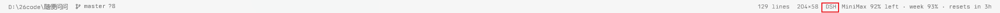
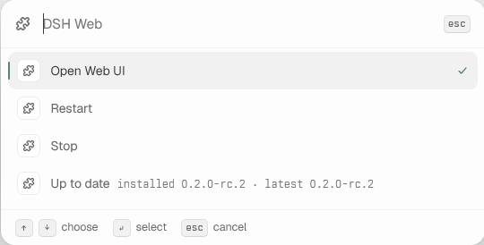
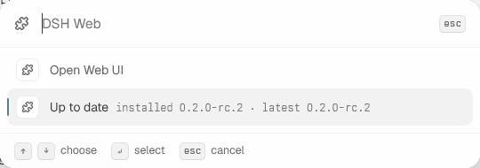

# tern-dsh-web

A [Tern](https://tern.build) plugin that starts the [DeepSeek Harness](https://github.com/deepseek-ai/deepseek-harness)
Web UI on demand and opens it in a browser block.



Clicking the `DSH` segment in the bottom status bar opens a menu:



When the server is stopped, the menu offers only what applies:



## What it does

- **Open Web UI** — starts the server if it is not running, then opens it in a
  browser block. An already-healthy browser block is reused rather than stacked.
- **Restart** — stops the server and starts it again.
- **Stop** — stops the server and releases the port.
- **Up to date** — shows the installed and the latest published version. A
  newer version available is marked with `↑` on the segment.

The status line reflects what is actually listening on the port: the segment
turns from `DSH running` back to `DSH` within seconds of the server going
away, whether it was stopped here or died on its own.

## Install

The plugin has to be linked into Tern, because it lives in a directory of its
own rather than in Tern's own plugin folder:

```sh
tern plugin link "D:/path/to/tern-dsh-web"
```

Then reload it:

```sh
tern plugin reload
```

`tern plugin list` prints `dsh-web 1.0.0 DSH Web` once Tern has claimed it.

To unlink:

```sh
tern plugin unlink dsh-web
```

## Requirements

- Node.js on `PATH` — the plugin starts the server with `node`.
- npm — it is used to resolve the package and to find npm's cache directory.

The server is the published package `@deepseek-ai/dsh`. The first launch
downloads it, which takes a few minutes; later launches reuse the cache.

## Where things live

| Path | What |
|---|---|
| `<tern plugin data>/dsh-web/dsh-web.log` | The server's stdout. Its first line is the access URL, with the token. |
| `$(npm config get cache)/_npx/<hash>/` | The downloaded package. The hash differs per version range, so `@latest` picks up new releases. |

The log is truncated on every launch and removed on stop, so the token of a
stopped server can never be read back by mistake. The token changes on every
run and is not stored anywhere else.

## How the server is started

The server runs detached: it outlives the pane, the window and the plugin
reload, and no console window is opened for it. The plugin is a client of a
service that keeps running, not an owner of it — the only way to stop it is
the menu's **Stop**.

That is also why the token is read out of a log file rather than taken from
the process's output. `dsh web` prints its access URL — with a token — to
stdout only, and prints it once the server is listening, which on a first run
is minutes after the launch. The child process inherits the log file's own
descriptor, so the output keeps being written after the launcher is gone.

## Troubleshooting

**The segment says `DSH` but the port answers.** Something other than DSH
holds port 3080. The menu reports it as blocked and refuses to start, because
starting anyway would fail with a confusing error.

**A start fails with "gave up waiting".** The first launch downloads the
package; the log says how far it got. `dsh web` also writes its own logs
under `~/.dsh/`.

**The version check says "checking…" forever.** The registry request failed.
The reason is shown in the toast.

## License

MIT. See [LICENSE](LICENSE).
